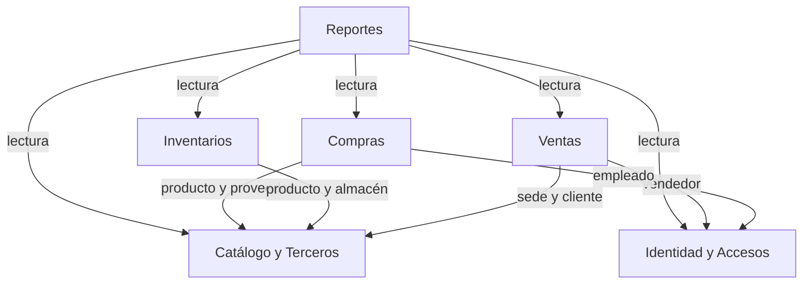

# Arquitectura de datos de DistribuRed

## Alcance y reglas

DistribuRed administra catálogos, sedes, almacenes, compras, existencias,
traslados, ventas, pagos y devoluciones en una empresa con tres sedes comerciales
y un centro de distribución. Los maestros se identifican de forma estable y los
detalles conservan el precio o costo histórico. Los pagos confirmados reducen el
saldo. Las recepciones y devoluciones se verifican contra las líneas de sus
documentos. Origen y destino de un traslado deben ser distintos.

## Propiedad e integración

| Servicio | Entidades o vistas bajo su responsabilidad | Consulta local de ejemplo |
|---|---|---|
| Catálogo y Terceros | Sede, almacén, categoría, producto, proveedor, producto-proveedor, cliente | Productos por categoría |
| Identidad y Accesos | Empleado, usuario, auditoría | Accesos de un usuario |
| Compras y Abastecimiento | Orden, detalle de orden, recepción y detalle | Pendientes por orden |
| Inventarios y Transferencias | Inventario, transferencia y detalle | Existencias por almacén |
| Ventas y Pagos | Pedido, detalle, pago, devolución y detalle | Pagos confirmados del pedido |
| Reportes Corporativos | Vistas de lectura | Reporte corporativo por sede |

Cada servicio posee una instancia PostgreSQL. La independencia de las consultas
locales se verifica por conexión directa. Las consultas corporativas requieren
las fuentes que usan. La arquitectura de aplicación se modela conceptualmente.
La variante de una instancia con esquemas, descrita como mínimo en el enunciado,
simula la arquitectura de datos y por sí sola no demuestra despliegue independiente.

## Modelo conceptual y relacional

- Sede 1:N Almacén y Sede 1:N Empleado. Categoría 1:N Producto y relación
  recursiva padre 0:1 e hijas 0:N. Producto N:M Proveedor por Producto_Proveedor.
- Orden 1:N Detalle de orden y Orden 1:N Recepción. Recepción 1:N Detalle de
  recepción. Una línea puede recibirse en varias recepciones.
- Almacén N:M Producto mediante Inventario. Transferencia 1:N Detalle y un
  almacén por cada papel de origen y destino.
- Sede, Cliente y Empleado poseen cada uno una relación 1:N con Pedido.
  Pedido 1:N Detalle, 1:N Pago y 1:N Devolución, con participación opcional de
  pagos y devoluciones. Devolución 1:N Detalle asociado a la línea vendida.
- Empleado 1:0..1 Usuario y Usuario 1:N registros de auditoría.
- Tipos, claves candidatas, PK, FK locales y restricciones por atributo se
  documentan en [sql/esquemas](../sql/esquemas). Los identificadores entre
  servicios se validan con [consultas de control](../sql/pruebas/referencias_distribuidas.sql).

Los atributos son atómicos. Los detalles y asociaciones dependen de sus claves
compuestas completas. Categorías, sedes, clientes y proveedores conservan sus
atributos propios para evitar dependencias transitivas en documentos. Los precios
históricos son atributos de la línea. `total_registrado` e `id_sede` en Inventarios
son redundancias explícitas controladas mediante consultas de integridad.

## Distribución y consolidación

Inventarios se divide por LIST de `id_sede` y conserva la PK
`(id_sede,id_almacen,id_producto)`. Pedidos de venta se divide por la misma
condición y conserva `(id_sede,id_pedido)`; las FK locales conservan ambos IDs.
Las cuatro condiciones de partición son disjuntas. La partición comercial de la
sede 4 existe y está vacía porque es centro de distribución. Una inserción con
una sede fuera de la cobertura se rechaza. PostgreSQL reúne los fragmentos al
consultar la tabla padre. Las vistas unificadas proyectan estas tablas desde
Reportes, usando postgres_fdw y una cuenta lectora distinta por instancia.

## Matriz de permisos de la aplicación SQL

| Rol | SELECT | INSERT | UPDATE | DELETE |
|---|---|---|---|---|
| Administrador | Esquemas operativos y reportes | Operativos | Operativos | Operativos |
| Gerencia | Catálogo, operativos según concesión, vistas corporativas; en Identidad, empleados y auditoría | — | — | — |
| Responsable de inventario | Catálogo básico e Inventarios | Inventarios | Inventarios | — |
| Responsable de compras | Catálogo básico, proveedores y Compras | Compras | Compras | — |
| Vendedor | Catálogo básico, clientes, pedidos, detalles y pagos | Pedidos, detalles y pagos | Pedidos, detalles y pagos | — |
| Auditor | Tablas autorizadas y vistas corporativas | — | — | — |

La matriz especifica permisos por objeto. Las consultas operativas usan el filtro
de sede. El aislamiento de filas para usuarios finales requiere RLS u otra
autorización de aplicación. El enunciado excluye autenticación web y RLS de las
pruebas obligatorias.
